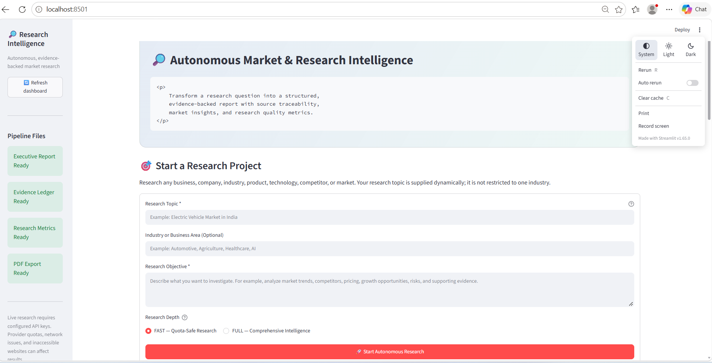
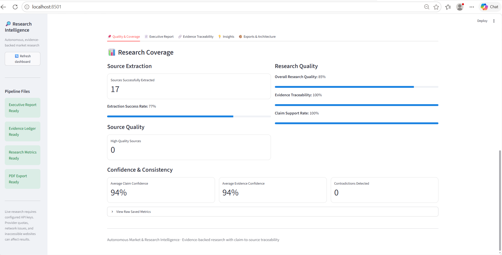
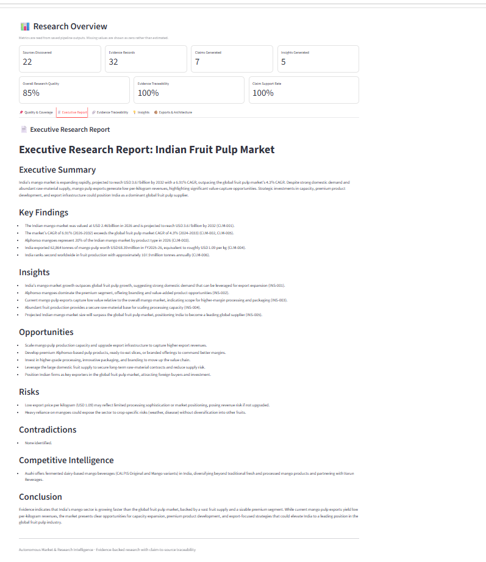
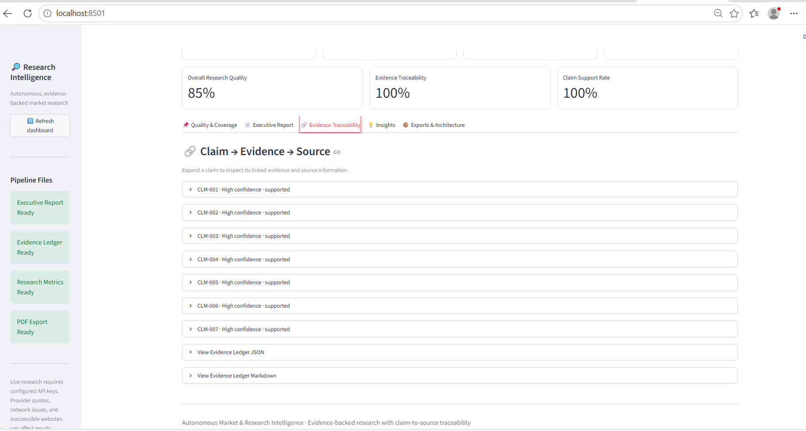
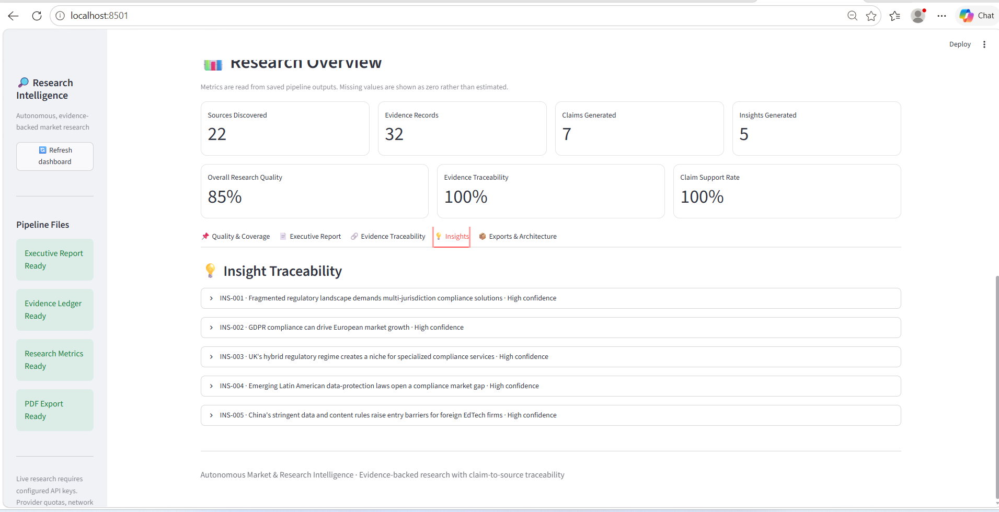
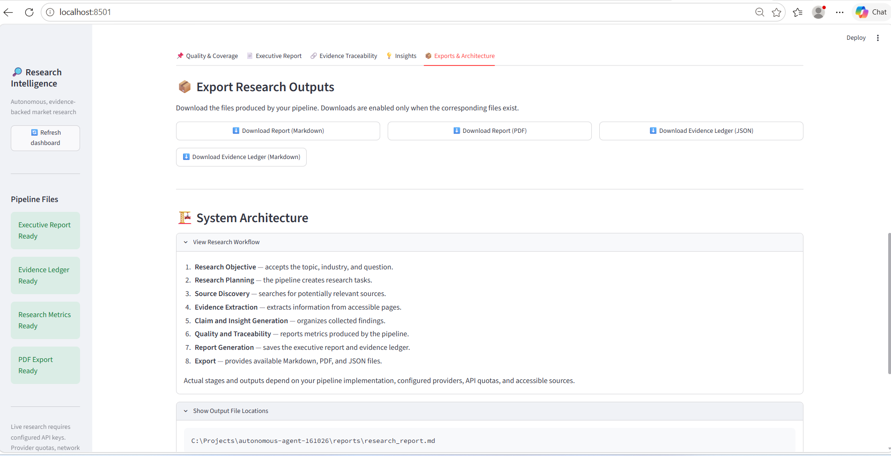

# Autonomous Market & Research Intelligence Agent

An AI-powered research intelligence system designed to transform research objectives into structured, evidence-backed market intelligence reports. It combines web search, LLM-powered analysis, evidence traceability, research metrics, and automated report generation in a unified workflow.

**Project Status:** Functional Prototype Completed

---

## Project Overview

The Autonomous Market & Research Intelligence Agent helps automate the process of researching a market, organizing supporting evidence, identifying insights, and generating structured reports.

The system is designed to support:
- Market research and emerging trend discovery
- Competitor and industry analysis
- Research evidence collection and traceability
- Insight generation and strategic decision support
- Structured research reporting and PDF exports

The architecture is intended to support research across different industries and business topics, depending on available sources and configured APIs.

## Key Features

- **AI-Powered Analysis:** Uses Google Gemini for research analysis and insight generation.
- **Web Research:** Integrates Tavily Search to discover relevant online information.
- **Research Pipeline:** Processes research objectives through a structured workflow.
- **Evidence Collection:** Organizes supporting evidence and source information.
- **Evidence Traceability:** Helps connect research claims and insights to supporting evidence.
- **Contradiction Detection:** Includes a component for identifying potentially conflicting evidence.
- **Research Metrics:** Tracks research-related metrics and exports structured results.
- **Insight Generation:** Converts collected information into actionable research findings.
- **Automated Reporting:** Produces structured research reports.
- **PDF Export:** Supports exporting research findings into PDF format.
- **Interactive Dashboard:** Uses Streamlit to display research results and metrics.
- **Testing:** Includes tests for important pipeline and research components.

## Project Screenshots

Explore the application's interface and research outputs below.

### 1. Dashboard Overview



### 2. Research Metrics



### 3. Executive Research Report



### 4. Evidence Traceability



### 5. Research Insights



### 6. Export Center



---

## System Architecture

The research workflow follows this general sequence:

1. **Research Objective** — Define the topic and research goal.
2. **Research Planning** — Organize the research process.
3. **Web Research** — Discover relevant information using configured search services.
4. **Evidence Collection** — Extract and organize supporting information.
5. **Evidence Traceability** — Connect findings with their supporting evidence.
6. **Analysis and Insights** — Analyze collected information and identify useful findings.
7. **Metrics and Reporting** — Generate research metrics and structured reports.
8. **Presentation and Export** — Review the results through the dashboard and available export options.

## Technology Stack

| Technology | Purpose |
|---|---|
| Python | Core application development |
| Google Gemini | LLM-powered research analysis |
| Tavily Search | Web information discovery |
| Pydantic | Data validation and structured models |
| Streamlit | Interactive dashboard |
| JSON and Markdown | Structured data and reports |
| PDF generation tools | Research report exports |
| Python testing tools | Component and pipeline validation |
| Git and GitHub | Version control and project hosting |

## Repository Structure

```text
autonomous-agent-161026/
├── app/
│   ├── pipeline.py
│   ├── dashboard.py
│   ├── services/
│   │   ├── evidence_ledger.py
│   │   ├── metrics_exporter.py
│   │   ├── pdf_report_exporter.py
│   │   └── research_metrics.py
│   └── test_*.py
├── reports/
├── screenshots/
│   ├── 01_dashboard_overview.png
│   ├── 02_research_metrics.png
│   ├── 03_executive_report.png
│   ├── 04_evidence_traceability.png
│   ├── 05_insight.png
│   └── 06_export_center.png
├── .gitignore
└── README.md
```

*This is a representative overview. Additional files and services may exist in the repository.*

## Installation and Setup

### Prerequisites

- Python installed on your system
- Git
- API credentials for the external services required by the application

### 1. Clone the repository

```bash
git clone https://github.com/srush9356-source/autonomous-agent-161026.git
cd autonomous-agent-161026
```

### 2. Create a virtual environment

```bash
python -m venv .venv
```

Activate it on Windows PowerShell:

```powershell
.\.venv\Scripts\Activate.ps1
```

### 3. Install dependencies

If the repository contains `requirements.txt`, run:

```bash
pip install -r requirements.txt
```

If it does not, install the dependencies specified by the project and its import statements.

### 4. Configure API credentials

Configure the API credentials required by your application, such as Google Gemini and Tavily Search, using the environment variable names expected by the code.

**Security:** Never commit API keys, `.env` files, or other confidential credentials to GitHub.

### 5. Launch the dashboard

From the project root, run:

```bash
python -m streamlit run app/dashboard.py
```

Streamlit will display a local URL in the terminal. Open that URL in your browser to use the dashboard.

### 6. Run the research pipeline

The pipeline's execution method and required inputs depend on the implementation in `app/pipeline.py`. Follow the entry point and configuration defined in that file.

## Example Use Case

### Indian Fruit Pulp Market Research

One intended application is researching the Indian fruit pulp industry for business planning.

Example research areas include:
- Market trends and growth opportunities
- Competitor activities and positioning
- Pricing signals and industry developments
- Export opportunities
- Evidence-backed findings for strategic planning

The same general research approach can be applied to other topics by providing an appropriate research objective and configuring the required services.

## Testing

The repository includes tests for selected application components.

To run tests, first inspect the available test files and project dependencies. If the project is configured for pytest, use:

```bash
python -m pytest
```

Run individual test modules when you need to validate a specific component.

## Future Improvements

Potential areas for further development include:

- Advanced multi-agent orchestration
- More comprehensive contradiction detection
- Enhanced source reliability scoring
- Deeper competitive intelligence and market-gap analysis
- Improved confidence calibration and research evaluation
- Additional dashboard visualizations
- Broader automated testing and error handling

These are potential enhancements, not claims that every capability has already been implemented.

## Learning Outcomes

This project provides practical experience with:

- Building LLM-powered Python applications
- Integrating web search with AI workflows
- Designing evidence-backed research pipelines
- Organizing structured data and research metrics
- Implementing evidence traceability
- Generating automated reports and dashboard views
- Testing and maintaining a modular application

## Author

**Srushti Pritam Jadhav**

GitHub: [@srush9356-source](https://github.com/srush9356-source)

---

*An AI/ML project exploring how web research and language models can support structured, evidence-backed market intelligence.*